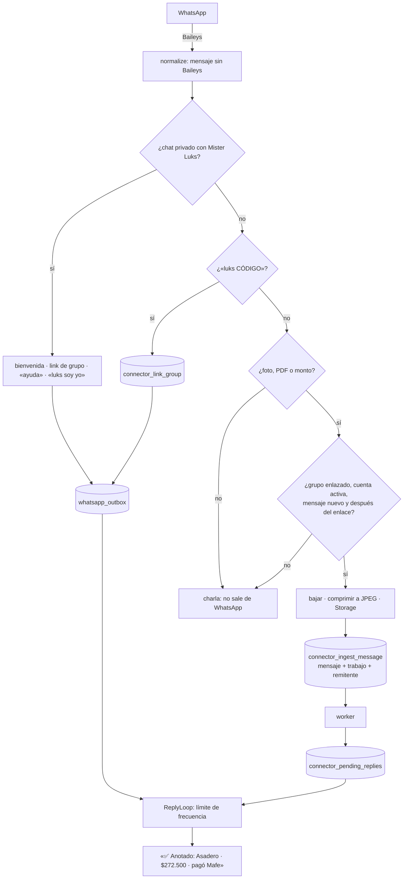

# Luks · connector de WhatsApp

Lee los grupos de WhatsApp enlazados a una cuenta de Luks y deja en la cola lo que parece un gasto: fotos de recibos, PDFs y mensajes con montos. El [worker](../worker/README.md) los vuelve gastos. Con el número contador, **Mister Luks**, también atiende los chats privados: da la bienvenida con la guía, entra a los grupos cuyo link le mandan, responde «ayuda» y con «luks soy yo» manda el link para verificar el número. Node 22, TypeScript y [Baileys](https://github.com/WhiskeySockets/Baileys) 7.



## Qué hace

| | | Dónde |
|---|---|---|
| Sesiones | El **número contador** (uno, el que la gente agrega a sus grupos) y **vinculaciones personales** opcionales (Luks lee los grupos desde el WhatsApp de alguien, sin agregar el contador). Se piden desde la web o la CLI y el connector las arranca solo | `manager.ts` |
| Reconexión | Si se cae, se reconecta con espera creciente (2 s … 1 min). Si la cierran desde el teléfono o no la vinculan a tiempo, borra las credenciales, la marca desconectada y **avisa** (Sentry, logs, `/health` y la pantalla de Conectar WhatsApp) | `whatsapp/baileys.ts` |
| Vincular con código | WhatsApp cierra la conexión si nadie vincula en ~2,5 min, y el código de 8 letras solo sirve en la conexión que lo pidió: cada reconexión pide uno nuevo (la web muestra siempre el vigente) y olvida el anterior, para no entrar como si ya estuviera vinculada. Si piden el código mientras se mostraba el QR, la sesión arranca otra vez con el número. Tres intentos sin vincular (~8 min) y se rinde | `whatsapp/baileys.ts`, `manager.ts` |
| Credenciales | Las de Baileys (creds y cada llave de Signal) se guardan **cifradas con AES-256-GCM** en Postgres (`whatsapp_connections`, `whatsapp_session_keys`). El contexto del cifrado ata cada valor a su sesión y su llave | `crypto.ts`, `whatsapp/auth-state.ts` |
| Integrantes | Manda la lista de quién está en cada grupo (número o «lid:…», el nombre que cada uno se puso en WhatsApp y si es admin) al conectarse y cada vez que alguien entra o sale, **solo** de los grupos enlazados a una cuenta o que lee el contador (migración 280). Cada integrante de un grupo enlazado queda como persona de esa cuenta (migración 160) | `ingest.ts`, `whatsapp/baileys.ts`, `whatsapp/normalize.ts` |
| Grupos | Cuando agregan a Mister Luks a un grupo, guarda el grupo, su presencia, su gente y el saludo en una sola llamada (`connector_group_detected`, migración 330) y saluda una vez, con la guía. Sin cuenta, el saludo nombra a quienes del grupo tienen su número verificado (la cuenta los espera en la app) o, si no reconoce a nadie, pide que quien ya tenga cuenta (con Gmail, por ejemplo) escriba «luks soy yo» y que, si no, **una sola persona** la cree; en los dos casos con un link `mrluks.com/g/CÓDIGO`. Ese código también se crea al mandar el mensaje (`connector_group_link_mint`): solo queda su hash, vence a las dos semanas y sirve una vez; si el grupo ya tiene cuenta, la línea del link se quita. «ayuda» en un grupo sin cuenta lo vuelve a mandar. **`luks CÓDIGO`** sigue sirviendo (también `lucas CÓDIGO`, el nombre de antes). Mister Luks y un WhatsApp vinculado pueden estar en el mismo grupo: cada sesión tiene su presencia (`whatsapp_group_sessions`) y el grupo lo lee principalmente Mister Luks | `ingest.ts`, `replies.ts` |
| Grupos conectados desde la web | Con el WhatsApp vinculado, la persona elige uno de sus grupos en la web y crea su cuenta (o lo conecta a una suya). Como sin cuenta no se guarda quién está en el grupo, el connector lo lee en su siguiente vuelta, cada 15 s (`connector_groups_pending_members`), y cada uno queda como persona de la cuenta | `manager.ts` |
| Chats privados | Solo los del contador: la sesión personal de alguien nunca lee sus chats privados. La primera vez, la bienvenida con la imagen y el PDF de [mrluks.com/guia](https://mrluks.com/guia); un link `chat.whatsapp.com/…`, entra al grupo (con tope por hora: `JOINS_MAX_PER_HOUR`); «ayuda» o «instrucciones», la guía otra vez. Del chat solo queda que esa persona escribió primero: ni su nombre ni sus mensajes | `ingest.ts`, `whatsapp/normalize.ts` |
| «luks soy yo» | En un grupo con Mister Luks o por privado: si el número ya está verificado, lo saluda por su nombre; si no, en el grupo dice los últimos 4 números y por privado (lo pidió) manda un link `mrluks.com/v/CÓDIGO` para asociarlo a su cuenta de Luks. El código se crea al mandar el mensaje (`connector_verify_mint`): en la base solo queda su hash, sirve una vez y vence en 30 minutos (migración 310). Como mucho una vez cada 10 minutos por persona. La web va en `WEB_URL` | `ingest.ts`, `replies.ts` |
| ¿Desde cuándo anoto? | Al enlazar el grupo, el «¡Listo!» pregunta: *1* desde ahora o *2* todo el chat. Cualquiera responde con «1» o «2» (si la pregunta sigue abierta) y cualquiera lo cambia después con «luks desde ya» o «luks lee todo» (o mencionando a Mister Luks). La base guarda la respuesta y Mister Luks anuncia quién decidió (migración 340). Mister Luks no ve lo que se escribió antes de que lo agregaran: «todo el chat» es que le manden el chat exportado | `ingest.ts`, `text.ts` |
| Preguntas a Mister Luks | Le hablan mencionándolo, empezando con «luks» («mrluks», «mister luks») o respondiendo un mensaje suyo. Reglas fijas en español e inglés: «cuánto llevamos», «quién le debe a quién» (como Liquidar en la app: `liquidacion.ts` es la misma cuenta, y `test/liquidacion.test.ts` revisa que dé lo mismo), «cuánto debo», «mis gastos», «privado» / «aquí», «no me cuentes» / «cuéntame». Lo que no entiende lo clasifica Qwen (`OLLAMA_BASE_URL`; solo dice qué preguntan). Los números salen de `connector_question` (migración 350). Lo del grupo se responde en el grupo; lo de cada quien, como lo prefiera (la primera vez pregunta «¿privado o aquí?» y se acuerda). En un grupo que lee solo un WhatsApp vinculado no se escribe en el grupo: Mister Luks le responde por privado a quien preguntó. «no me cuentes»: desde ahí no se baja ni se guarda lo que esa persona manda en esa cuenta (lo de antes queda igual). Las respuestas firman «Más detalle en mrluks.com» para que nadie las anote como gasto | `ingest.ts`, `preguntas.ts`, `qwen.ts`, `text.ts` |
| «luks elimina este gasto» | Responden (citan) el mensaje de un gasto (la foto, el PDF, el texto o la lista de «¿quién pidió qué?») hablándole a Mister Luks: «luks elimina este gasto», «@Mister Luks bórralo», «mrluks quita eso», «luks delete this expense». La base (`connector_eliminar_gasto`, migración 510) lo elimina como «Eliminar» en la app y deja el mensaje como «no era un gasto». Lo puede eliminar quien lo mandó, quien lo pagó o quien administra la cuenta; lo liquidado no se toca. Sin cita, Mister Luks explica cómo (como mucho cada 10 minutos por grupo). La respuesta firma «Más detalle en mrluks.com» | `ingest.ts`, `eliminar.ts` |
| Chat exportado | El .zip o .txt de «Exportar chat», en un grupo enlazado o por privado (si se sabe de qué grupo es: está en él y el nombre del archivo coincide). Va al bucket privado `importaciones` (hasta `IMPORT_MAX_MB`, 50 por defecto) y a la cola del worker, que lee solo lo de antes de que Luks empezara a anotar. Una vez por mensaje aunque lo lean dos sesiones; solo Mister Luks responde | `ingest.ts`, `whatsapp/normalize.ts` |
| Ingesta | Solo de grupos enlazados, solo lo escrito desde `ingest_from` (el enlace), sin repetir (`unique (group_id, wa_message_id)`). Fotos a JPEG de 1600 px; PDFs tal cual (máximo 6 MB, el límite del bucket) | `ingest.ts`, `media.ts` |
| Remitentes | Cada número que escribe queda anotado por cuenta. Los que no son de nadie le aparecen a un admin en la web: «¿Quién es este número?». En grupos con LID (WhatsApp oculta el número) se intenta traducir a número; si no se puede, queda «lid:…» | `whatsapp/normalize.ts` |
| Lo que escribe | Las confirmaciones de los recibos (apagadas por defecto desde la migración 315: un admin las prende por grupo; lo que llegó seguido va en un solo mensaje) y la **bandeja de salida** (`whatsapp_outbox`: bienvenida, saludo, guía, respuestas y lo que contesta a las preguntas). Lo mismo no se manda dos veces (`dedupe_key`), por privado solo a quien escribió primero, y todo con el mismo límite: mínimo 20 s entre mensajes del mismo chat, 20 por hora por chat y 60 en total. Solo escribe el contador, nunca una sesión personal | `replies.ts`, `text.ts` |
| Monitoreo | `/health` (contador conectado), `/health/cola` (la cola del worker avanza) y `/health/vivo`, para Uptime Kuma | `health.ts` |

### La interfaz `MessagingConnector`

Nada de la ingesta, el enlace ni las confirmaciones sabe que detrás está Baileys: todo depende de [`connector.ts`](src/connector.ts). Para pasar a la **API oficial (WhatsApp Cloud API)** basta otra implementación: recibe los mensajes por webhook y los entrega con `onMessage` como `IncomingMessage`, y `send` llama a su endpoint.

```ts
interface MessagingConnector {
  start(): Promise<void>;          // conecta y se reconecta solo
  stop(): Promise<void>;           // deja de escuchar sin desvincular
  logout(): Promise<void>;         // desvincula
  isConnected(): boolean;
  groups(): ReadonlySet<string>;   // grupos donde está
  members(chatId: string): Promise<GroupMember[]>;          // quiénes están (solo si se van a guardar)
  send(chatId: string, m: Outgoing): Promise<string | null>; // texto, o imagen o documento por URL
  joinGroup(inviteCode: string): Promise<JoinResult>;       // entrar con el link de un grupo
}
```

## Correr

En el servidor va con todo lo demás: ver [deploy/README.md](../../deploy/README.md).

```bash
docker compose exec connector node dist/cli.js vincular-contador [573001234567]
docker compose exec connector node dist/cli.js estado
docker compose exec connector node dist/cli.js desvincular-contador
```

Las variables están explicadas en [.env.example](.env.example). Las obligatorias son `SUPABASE_URL`, `SUPABASE_SERVICE_ROLE_KEY` y `SESSION_ENCRYPTION_KEY` (`openssl rand -base64 32`).

## Desarrollo

```bash
pnpm --filter @lucas/connector test        # 59 pruebas: cifrado, textos, normalización, ingesta, límites y sesiones
pnpm --filter @lucas/connector typecheck
pnpm --filter @lucas/connector dev         # con un .env propio (no uses el número contador de producción)
```

Las funciones de la base que usa están en `supabase/migrations/00000000000080_whatsapp_connector.sql`, con sus pruebas en `supabase/tests/whatsapp.test.ts`.

## Privacidad

- Solo se guarda lo que parece un gasto; la conversación del grupo no sale de WhatsApp.
- De los grupos de una vinculación personal que no son de una cuenta solo se guardan el nombre y el JID: ni quiénes están ni mensajes. Al desconectar un grupo se olvidan sus integrantes (salvo que lo lea el contador).
- Los logs y Sentry llevan ids, estados y tiempos, nunca el texto de los mensajes ni números completos (`57•••4567`).
- Las credenciales de WhatsApp nunca quedan en claro fuera de la memoria del proceso.
